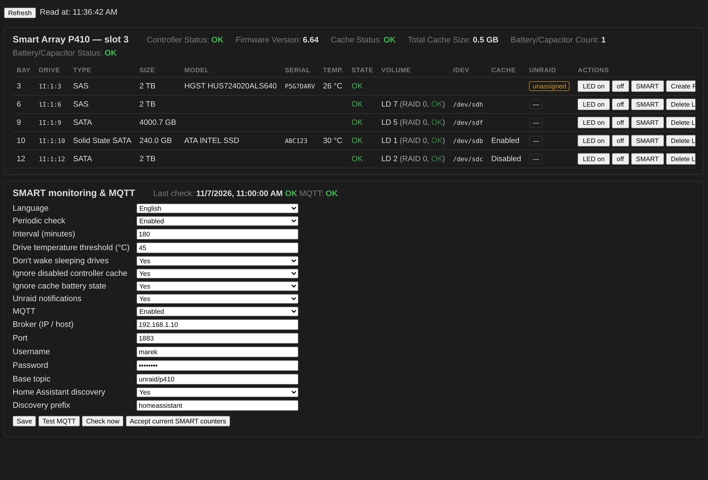
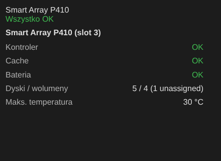

# Smart Array P410 for Unraid

Manage HP Smart Array controllers (P410 / P410i / P212 / P812 and related G6/G7 models) directly from the Unraid web UI, without rebooting into the Option ROM.



## Features

- **Status:** controller, firmware, cache and battery/capacitor state.
- **Drive map:** bay → physical drive → logical drive (LD) → `/dev/sdX` → Unraid slot, with model, serial, temperature and LD cache state.
- **SMART through the controller** (`smartctl -d cciss,N`), with the correct index found automatically by serial number.
- **Locate LED** on/off per drive.
- **Create RAID0 LD** from an unassigned drive (P410 has no HBA mode, so every disk needs its own RAID0 volume).
- **Delete LD**: you must type the LD number, and it is refused while the device is assigned in Unraid or mounted.
- **Enable LD cache** (only offered when the controller cache is working).
- **Periodic monitoring:** controller, LDs and SMART for all drives. The following are reported as problems:
  - any status other than OK,
  - pending or uncorrectable sectors,
  - growth of reallocated sectors, grown defects or uncorrected errors since the baseline,
  - temperature above the threshold.

  Failed-battery and disabled-cache warnings can be ignored until you replace the battery.
- **Unraid notifications** when problems appear and when they clear.
- **MQTT + Home Assistant discovery.** Built-in MQTT client, so nothing extra is needed on Unraid. Topics:
  - `unraid/p410/state` (JSON summary),
  - `unraid/p410/problem` (ON/OFF),
  - `unraid/p410/bay/N` (per bay),
  - `unraid/p410/alert` (new problems only).
- **Dashboard tile** (Unraid 6.12+).
- **Languages:** English (default) and Polish, chosen automatically or manually.



## Installation

**Plugins → Install Plugin** and paste:

```
https://raw.githubusercontent.com/francuz152/unraid-p410mgr/main/p410mgr.plg
```

The page is under **Settings → User Utilities → Smart Array P410**.

During installation the plugin downloads `hpssacli-2.40-13.0_amd64.deb` from the official [HPE Software Delivery Repository](https://downloads.linux.hpe.com/SDR/repo/mcp/pool/non-free/) and caches it on the flash drive, so later boots work offline. hpssacli is HPE software and is subject to the HPE license; it is not distributed with this plugin.

## Notes

- Tested on a Smart Array P410 (firmware 6.64) in an HP StorageWorks P4500 G2 / DL180 G6 chassis.
- Unraid counts every logical drive as an attached device for licensing.
- Uninstalling keeps your settings in `/boot/config/plugins/p410mgr/`. Delete that folder for a full removal.
- Building from source: `python3 build.py` assembles `src/` into `p410mgr.plg`.

## Polski

Plugin do zarządzania kontrolerami HP Smart Array (P410 i pokrewnymi) z poziomu GUI Unraida:

- stan kontrolera, mapowanie kieszeń → wolumen → `/dev` → slot Unraida, SMART przez cciss, dioda lokalizacyjna,
- tworzenie i usuwanie wolumenów RAID0 bez restartu,
- cykliczne sprawdzanie z powiadomieniami, MQTT z autodiscovery dla Home Assistanta, kafelek na Dashboard.

Interfejs jest dostępny po polsku: ustaw **Język → Polski** albo zostaw **Automatyczny**, jeśli Unraid ma polską wersję językową.

## License

MIT. See [LICENSE](LICENSE). HPE hpssacli is not covered by this license.
